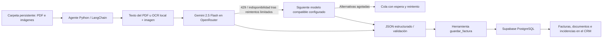

# Automatización de facturas · La Mesa Perfecta

## Validar y denegar desde la tabla · 30/10/2026

La columna Acciones ofrece ✓ Validar y × Denegar directamente por factura,
con nombres accesibles y confirmación para denegar. Denegar mantiene los datos
y el original en Descartadas. No se cambia el estado visual hasta confirmar el
guardado. Los recuentos se recargan tras la operación. El número de factura abre
la corrección de datos; se ha retirado el botón Ver factura y las acciones de
validación de esa ficha para centralizarlas en la tabla.

## Lectura automática y contador · 30/10/2026

La factura de práctica subida estaba en disco, pero el lector no se estaba
ejecutando. Se ha procesado con Gemini 2.5 Flash y guardado realmente en Supabase:
`PRACT-2026-001`, proveedor Suministros Demo Catering, S.L., NIF B12345674,
base 1.000,00 EUR, IVA 210,00 EUR, total 1.210,00 EUR, revisión pendiente y
original privado disponible. La API del CRM local devuelve HTTP 200 y
`recuentos.pendiente = 1`. No se han insertado datos manualmente para simular lectura.

`npm run dev` y `npm start` ahora arrancan también el lector mediante
`scripts/crm-with-reader.cjs`. Requieren el entorno Python y `.env.local`
configurados. Si se usa un servicio de lectura externo, definir
`FACTURAS_READER_MODE=external`. `FACTURAS_PYTHON` permite indicar otro ejecutable.
El bloqueo de sistema operativo `.lector.lock` impide ejecutar dos lectores
locales sobre la misma carpeta y se libera al terminar el proceso. No sustituye
los bloqueos transaccionales de Supabase. Se ha dejado el lector activo en este
equipo, con registros en `.data/facturas/lector.stdout.log` y `lector.stderr.log`.

El listado y sus contadores se consultan cada 10 segundos mientras la página
está visible; puede pausarse. La actualización en segundo plano conserva filtros,
no desactiva el botón manual ni interrumpe una ficha o diálogo de subida.
Al terminar una subida se solicita también una recarga inmediata. «Por revisar»
cuenta facturas ya leídas pendientes de validar; no se aumenta por un archivo
que todavía no ha sido extraído.

Comprobado: extracción real del PDF subido, persistencia y lectura de su original,
29 pruebas Python (incluido bloqueo del lector y recuperación tras error),
13 pruebas Node y rechazo de una segunda ejecución local del lector.

## Subir desde Facturas a la carpeta de entrada · 30/10/2026

La entrada habitual es ahora **Facturas → Subir facturas → Elegir archivos →
Guardar facturas**. El botón está junto a Actualizar facturas. Admite PDF,
JPG/JPEG, PNG y WebP, hasta 20 MB por documento y 10 archivos por tanda.
La carpeta local está creada en
`C:\Users\Juan\GestoriaCatering\.data\facturas\entrada` y está excluida de Git.
Puede configurarse con `FACTURAS_INPUT_DIR`, usando el mismo valor y directorio
de trabajo para Next.js y el agente Python.

La ruta autenticada `POST /api/crm/facturas/subir` comprueba sesión, origen,
límite real del cuerpo multipart, tamaño y cabecera del archivo. Guarda con un
nombre seguro y hash SHA-256, sin utilizar rutas proporcionadas por el navegador.
Escribe primero un temporal `.part` y publica el archivo completo con enlace
atómico: el lector ignora los temporales. Confirma existencia y tamaño antes de
responder. Un reintento del mismo archivo con el mismo nombre no sobrescribe ni
duplica el original. Cada archivo se envía de forma independiente; un fallo
conserva los pendientes en la ficha para reintentarlos sin repetir los éxitos.

El aviso de subida distingue **guardado en carpeta** de **datos extraídos**.
La subida funciona aunque el lector esté parado o Supabase no esté disponible;
el agente registrará y procesará los archivos al recorrer esa carpeta. No se ha
puesto en marcha el agente ni enviado documentos a la IA en esta ampliación.

Este modo escribe en el disco del servidor Next.js. En local es la carpeta de
Juan; una web en otro servidor no escribe en el PC del navegador. Para publicar
este modo se necesita disco persistente y acceso del agente a la misma carpeta;
el sistema de archivos efímero/de solo lectura de Vercel no sirve para esta
persistencia. No se redirige a una carpeta temporal que perdería los documentos.

Verificación: compilación de producción; 4 pruebas nuevas de carga, cabeceras,
tamaño sin Content-Length, sesión/origen, rutas, bytes guardados y duplicados;
9 pruebas existentes de Facturas. Subida real de un PDF ficticio desde el
selector del navegador a una carpeta temporal de pruebas, con comparación de
bytes correcta. La carpeta real de entrada queda preparada sin documentos de
prueba. Evidencia visual: `docs/accesibilidad/facturas-subida-2026-10-30.jpg`.

## Corrección del módulo · 30/10/2026

Aplicada en el proyecto `GestoriaCatering` la migración `revision_facturas_proveedores`
de `supabase/migrations/20261029124958_revision_facturas_proveedores.sql`.
El aviso de configuración procedía de columnas ausentes (`estado_revision` y
`archivo_ruta`), confirmado en los registros de PostgreSQL. La ampliación no
borra registros ni cambia las tablas comerciales.

La factura conserva proveedor, NIF/CIF, número, fecha, base imponible, IVA en
dinero, total y moneda. El desglose original conserva los porcentajes de IVA.
`datos_extraidos` mantiene una copia de la extracción inicial, incluso después
de corregir la factura. La ficha permite guardar correcciones incompletas,
validar con los campos completos y descartar sin borrar el registro ni su
original; una descartada puede volver a validarse. Cada guardado comprueba la
versión para impedir sobrescribir cambios simultáneos.

La tabla muestra NIF, base, IVA, total y estado de revisión; los filtros incluyen
Por revisar, Validadas y Descartadas. El éxito solo se muestra tras confirmar la
respuesta guardada, se actualiza la lista y se conserva el foco de teclado.
Los originales se sincronizan por hash en `facturas-originales`, un bucket
privado, y se abren desde una ruta autenticada con enlaces de 60 segundos.
Se admite la respuesta de duplicado de Storage al recuperar una subida anterior,
sin sobrescribir el original. El IVA admite los Decimal serializados como texto
por Python y conserva `null` si no consta, en vez de inventar cero.

Comprobado: compilación de producción, 9 pruebas Node, 27 pruebas Python,
pruebas PostgreSQL de ambas migraciones y guardado/revisión/concurrencia,
API local autenticada HTTP 200 para los cuatro filtros de revisión y función
real de guardado accesible al servidor. El comprobador
`node scripts/check-facturas-supabase.cjs` ahora verifica también las columnas
de revisión y su función sin modificar registros. Supabase sigue con cero
facturas y documentos: las pruebas pobladas de interfaz usan un proveedor ficticio
en un servidor local aislado que no escribe en Supabase.

**Límites actuales:** no se ha publicado esta versión de la web, ejecutado
inferencia ni procesado una factura real en esta revisión. La entrada de
documentos sigue requiriendo el agente Python en ejecución y Tesseract para
imágenes/PDF escaneados. No se ha activado un servicio permanente ni instalado
OCR. Consultar la revisión de accesibilidad para las pruebas manuales pendientes.

## Estado de la conexión · 29/10/2026

Se ha aplicado `activar_facturas_ia` (versión `20261029103634`) en Supabase `GestoriaCatering`
(`odentjiuagcrdqozccva`), creando las cuatro tablas y cinco funciones del módulo.
Comprobado con consultas: RLS activo, acceso anónimo y authenticated revocado,
SELECT/INSERT/UPDATE y funciones disponibles para service_role. Las cuatro tablas
están vacías. La prueba de lectura y reintento inexistente con service_role fue
correcta y se ejecutó dentro de una transacción con rollback.

El análisis de seguridad solo señala que estas tablas tienen RLS sin políticas:
es intencionado porque el módulo se sirve exclusivamente desde el backend y no
se conceden privilegios al cliente público. No se han abierto las facturas al
navegador para evitar utilizar la clave privada.

**Conexión local verificada el 29/10/2026:** clave privada configurada en
`.env.local` (excluido de Git), lectura correcta de las cuatro tablas y
`GET /api/crm/facturas` autenticado con respuesta HTTP 200. Las tablas están vacías
y todavía no hay un agente registrado. No se han enviado documentos a la IA.

**Pendiente para la web publicada:** configurar `SUPABASE_SECRET_KEY` o
`SUPABASE_SERVICE_ROLE_KEY` también en el proyecto Vercel correspondiente y
volver a desplegar. El archivo local no configura Vercel automáticamente. La URL
pública ya configurada se reutiliza sin cambiar de proyecto.

Verificación de solo lectura, sin mostrar claves ni contenido de facturas:

```powershell
node scripts/check-facturas-supabase.cjs
```

La conexión local de la aplicación ya supera esa comprobación y la de su API;
queda comprobar el entorno publicado. El estado descrito el 23/10/2026 más abajo
es histórico; la migración ya está aplicada.

Implementación del 23/10/2026. La integración añade «Facturas» al CRM sin cambiar
las tablas ni las operaciones comerciales o de RRHH. Se ha seguido el flujo escrito
en la solicitud; no había una imagen de arquitectura adjunta que se pudiera contrastar.



## Archivos y responsabilidades

| Archivo | Para qué sirve |
| --- | --- |
| `automation/__init__.py`, `automation/facturas/__init__.py`, `automation/facturas/tests/__init__.py` | Declaran los paquetes Python y permiten ejecutar el agente y descubrir sus pruebas |
| `automation/facturas/config.py` | Variables de entorno, límites, directorio y prioridad de modelos |
| `automation/facturas/documents.py` | Lectura de PDF, OCR de escaneados/imágenes y límites de tamaño |
| `automation/facturas/schema.py` | Prompt, JSON Schema, validación monetaria y avisos de datos ausentes |
| `automation/facturas/models.py` | Catálogo de OpenRouter, LangChain, clasificación de errores y respaldo |
| `automation/facturas/storage.py` | Cliente HTTPS PostgREST de Supabase y herramienta `guardar_factura` |
| `automation/facturas/worker.py` | Bucle secuencial de archivos, comprobación de copias en curso y recuperación |
| `automation/facturas/requirements.txt` | Dependencias Python acotadas por versión mayor |
| `automation/facturas/.env.example` | Configuración sin secretos; se copia a `.env` |
| `automation/facturas/facturas.service.example` | Ejemplo de servicio persistente para Linux |
| `automation/facturas/tests/test_agent.py` | Pruebas sin enviar documentos a una IA |
| `supabase/migracion_facturas_ia.sql` | Tablas, permisos, deduplicación y funciones transaccionales |
| `lib/invoices.ts` | Tipos compartidos, formatos y filtros de búsqueda |
| `lib/invoiceStore.ts` | Acceso a Supabase exclusivamente desde el servidor web |
| `app/api/crm/facturas/route.ts` | API autenticada de consulta y solicitud de reintento |
| `components/InvoiceModule.tsx` | Lista, ficha, cola, incidencias y modelos utilizados |
| `app/crm/facturas/page.tsx` | Ruta del nuevo apartado del CRM |
| `tests/invoices.test.cjs` | Pruebas de API, autenticación, filtros y formato monetario |
| `tests/invoices-sql.cjs` | Prueba de la migración con PostgreSQL embebido, sin tocar Supabase real |
| `docs/accesibilidad/facturas-configuracion.png` | Captura real del módulo con la configuración pendiente y el foco visible |

El único cambio de navegación es la entrada «Facturas» en `CrmShell`. Se reutilizan
sus controles, foco, sesión y estilos. El agente no utiliza memoria conversacional:
el estado necesario para recuperar procesos está en PostgreSQL.

## 1. Preparar Supabase

En el SQL Editor del proyecto de Supabase, revisa y ejecuta
`supabase/migracion_facturas_ia.sql`. No se ha ejecutado automáticamente contra
el proyecto real. Si ya existe una tabla `facturas` ajena a este repositorio, revisa
su compatibilidad antes de aplicar la migración. La transacción evita una aplicación parcial.

Se crean cuatro tablas:

- `facturas`: datos extraídos, impuestos, modelo, advertencias y documento de origen.
- `factura_documentos`: cola, SHA-256 único, intentos, próxima ejecución y bloqueo temporal.
- `factura_intentos`: modelo de cada intento, resultado, tipo de error y duración.
- `factura_agente`: última señal del proceso y mensaje de configuración/incidencia.

Todas tienen RLS activado y sin acceso para `anon` ni `authenticated`. La sesión
del CRM se valida en su API; únicamente el servidor y el agente usan la clave
secreta. Las funciones tampoco se conceden a roles públicos.

## 2. Instalar Python y OCR

Requiere Python 3.11 o posterior. Desde la raíz del repositorio, en PowerShell:

```powershell
python -m venv automation/facturas/.venv
.\automation\facturas\.venv\Scripts\python.exe -m pip install -r automation/facturas/requirements.txt
Copy-Item automation/facturas/.env.example automation/facturas/.env
```

En Linux:

```bash
python3 -m venv automation/facturas/.venv
automation/facturas/.venv/bin/python -m pip install -r automation/facturas/requirements.txt
cp automation/facturas/.env.example automation/facturas/.env
```

Instala también **Tesseract OCR**, con los idiomas español e inglés (`spa` y `eng`).
En Debian/Ubuntu: `sudo apt install tesseract-ocr tesseract-ocr-spa tesseract-ocr-eng`.
En Windows, usa una distribución de Tesseract indicada por el proyecto oficial y
configura `TESSERACT_CMD` con la ruta de `tesseract.exe` si no está en PATH.
Comprueba `tesseract --list-langs` antes de procesar escaneados. No se necesita
Poppler: pypdfium2 extrae texto y renderiza localmente los PDF.

En esta entrega se instaló un entorno Python aislado para las pruebas. No se
instaló Tesseract en el sistema; las pruebas OCR sustituyen la llamada a ese ejecutable.

## 3. Configurar las credenciales

Completa `automation/facturas/.env` en el servidor:

```dotenv
OPENROUTER_API_KEY=tu_clave_de_openrouter
SUPABASE_URL=https://tu-proyecto.supabase.co
SUPABASE_SERVICE_ROLE_KEY=tu_clave_de_servidor
FACTURAS_INPUT_DIR=.data/facturas/entrada
FACTURAS_FALLBACK_MODELS=google/gemini-2.5-pro,anthropic/claude-sonnet-4.6,openai/gpt-4.1
```

En el entorno del **servidor web**, configura `SUPABASE_SERVICE_ROLE_KEY` (o
`SUPABASE_SECRET_KEY`) y `SUPABASE_URL` (o la URL pública ya utilizada por el proyecto).
La web no necesita la clave de OpenRouter. Nunca uses prefijos `NEXT_PUBLIC_` para
claves secretas. El archivo del agente y su entorno virtual están excluidos de Git.
Las variables del proceso tienen prioridad sobre `.env`.

No se han creado ni mostrado credenciales. En el entorno revisado faltaban la
clave de OpenRouter y la clave de servidor de Supabase; por eso no se ha activado
el procesamiento de documentos reales ni aplicado la migración a producción.

## 4. Ejecutar y alimentar la carpeta

Todos los comandos se ejecutan desde la raíz del repositorio:

```powershell
# Solo consulta el catálogo; no envía documentos ni consume inferencia.
.\automation\facturas\.venv\Scripts\python.exe -m automation.facturas.worker --check-models

# Una pasada; útil para comprobar instalación y permisos.
.\automation\facturas\.venv\Scripts\python.exe -m automation.facturas.worker --once

# Proceso continuo. Ctrl+C solicita una parada ordenada.
.\automation\facturas\.venv\Scripts\python.exe -m automation.facturas.worker
```

En Linux sustituye la ruta del ejecutable por `automation/facturas/.venv/bin/python`.
La carpeta de entrada se crea si no existe. Copia allí archivos como `FAC-0153.pdf`,
`luz-sept.pdf` o `taxi.jpg`. Lo más fiable es copiar con extensión temporal y renombrar
al terminar. El agente comprueba tamaño/fecha en dos lecturas separadas antes de
procesar, toma una instantánea de bytes y **no mueve ni elimina el original**.
Solo se recorre el primer nivel; no se siguen enlaces simbólicos.

Para mantenerlo ejecutándose en Linux, adapta las rutas y el usuario de
`facturas.service.example` y configúralo como servicio con acceso a la carpeta
persistente. En Windows puede ejecutarse en un terminal o mediante un servicio
administrado por el servidor. El bucle Python es el que automatiza las pasadas.

Si la web está en Vercel, ejecuta el agente en un servidor o contenedor con disco
persistente. Una función web efímera no sirve para un bucle continuo ni para
vigilar una carpeta local. Ambos procesos se comunican mediante Supabase.

## Modelos y política de errores

El catálogo público de OpenRouter se consultó el 23/10/2026 y confirmó estos
identificadores con imagen y `structured_outputs`/`response_format`:

1. `google/gemini-2.5-flash`, siempre primero.
2. `google/gemini-2.5-pro`, alternativa de la misma familia orientada a razonamiento.
3. `anthropic/claude-sonnet-4.6`, alternativa multimodal de otro proveedor.
4. `openai/gpt-4.1`, alternativa multimodal con JSON estructurado.

Este orden de respaldo es una decisión de integración, no una clasificación
universal de precisión. Puede cambiarse con `FACTURAS_FALLBACK_MODELS`; Gemini
2.5 Flash se antepone automáticamente incluso si aparece repetido. No se eligen
modelos desconocidos ni se cambia de modelo por ser más nuevo o más barato.

El catálogo se verifica de nuevo al ejecutar, con caché máxima de 15 minutos.
Los modelos retirados o sin las capacidades exigidas se omiten y se registra el
motivo. La disponibilidad del catálogo no garantiza la cuota de una clave.
Se exige un proveedor que admita los parámetros de JSON estructurado.

| Situación | Comportamiento |
| --- | --- |
| 429: límite de uso/cuota del proveedor | Reintento limitado del mismo modelo; después siguiente modelo |
| Timeout, errores de red, 408 o 5xx | Mismo mecanismo de respaldo limitado |
| Alternativas agotadas | Cola `reintento`, espera exponencial y otra pasada posterior |
| 402: saldo o presupuesto de la cuenta OpenRouter | Detiene la tanda y espera cinco minutos; no cambia de modelo para intentar eludir un saldo compartido |
| 401/403: autenticación o permisos | Detiene el proceso con estado de incidencia; corregir y reiniciar |
| 400/404/422: identificador/parámetros/configuración | No recorre alternativas indefinidamente; corregir y reiniciar |
| Contexto de entrada excedido | Revisión del documento; dividirlo, sin tratarlo como cuota agotada |
| Respuesta cortada por tokens de salida | Revisión diferenciada; no guardar un JSON parcial |
| JSON inválido o dato con formato imposible | Revisión del archivo; no insertar valores no validados |
| Documento dañado o ilegible | Marcar para revisión y continuar con el siguiente |
| OCR no instalado/idioma ausente | Incidencia de configuración y parada; no recorrer modelos |
| Fallo al confirmar Supabase | Conservar el original y el bloqueo; recuperarlo al caducar, sin marcarlo completado |

Cada archivo dispone de cinco intentos automáticos por ciclo por defecto. La espera es
exponencial, limitada a una hora. Si persiste un fallo recuperable al agotarlos,
se reinicia el contador tras una pausa de una hora y continúa automáticamente:
una cuota diaria agotada no deja la factura abandonada en revisión. Los errores
de contenido o formato sí requieren revisión. Desde el CRM,
«Reintentar documento» vuelve a ponerlo en cola tras comprobar el resultado de
la operación; sirve después de corregir una incidencia. No reprocesa documentos
completados ni modifica las facturas ya guardadas.

Los límites de tamaño, páginas, texto, salida, tiempo y reintentos están en el
archivo de ejemplo. El texto no se trunca para encajarlo a escondidas. Los
importes se validan con Decimal y tolerancia contable de 0,02; no se completa un
campo ausente ni se asume EUR si el documento no indica moneda.

## Persistencia y límites de la extracción

- El hash SHA-256 evita procesar dos veces el mismo contenido aunque cambie el nombre.
- Proveedor identificado + número de factura + año evitan insertar otra copia
  escaneada de la misma factura. Si falta alguno, solo se puede asegurar la
  deduplicación por contenido. El nombre de proveedor por sí solo no identifica
  una factura. Revisa coincidencias legítimas si un proveedor reutiliza números.
- PostgreSQL reserva el documento con un token y una caducidad. Una ejecución
  antigua no puede guardar con un bloqueo caducado. Otro agente puede retomarlo.
- Guardar los datos y completar la cola forman una sola transacción. Una respuesta
  perdida después del commit no genera otra fila ni otro procesamiento confirmado.
- Impuestos negativos permiten registrar retenciones y facturas rectificativas.
  Las diferencias aritméticas se guardan con advertencias y estado de revisión.
- «Datos extraídos» no equivale a aprobación contable. La IA puede cometer errores;
  el panel mantiene visible la necesidad de contrastar con el documento original.
- No se suben originales a almacenamiento público. La visión recibe únicamente
  las páginas escaneadas o imágenes necesarias mediante HTTPS a través de
  OpenRouter y sus proveedores configurados. La extracción digital usa texto.
- El contenido de una factura nunca da instrucciones al agente. La herramienta
  de guardado recibe los identificadores y el modelo desde el proceso, no desde
  el JSON propuesto por la IA. No hay herramientas para ejecutar órdenes ni abrir enlaces.
- Los registros guardan identificadores, modelos, categorías y mensajes controlados,
  sin guardar prompts, claves, OCR completo ni respuestas brutas. El tracing
  externo de LangChain se desactiva explícitamente durante la inferencia.

## Pruebas reproducibles

```powershell
.\automation\facturas\.venv\Scripts\python.exe -m unittest discover -s automation/facturas/tests -v
node --test tests/invoices.test.cjs
npx tsc --noEmit --incremental false
npm run build
```

La prueba adicional de PostgreSQL se instala fuera de las dependencias del CRM:

```powershell
npm install --prefix tmp/facturas-sql-tests --no-audit --no-fund @electric-sql/pglite
node tests/invoices-sql.cjs
```

Comprueba migración, bloqueos, token caducado, duplicado comercial, separación por
año, espera de reintentos, vuelta a la cola, rollback atómico y acceso anónimo
denegado. Python comprueba rutas de respaldo con modelos simulados, la integración
real instalada de LangChain, JSON/Decimal, PDF digital, OCR simulado y conservación
del original ante errores de guardado. No se ha pagado inferencia ni enviado una
factura real durante estas pruebas.

Resultado de esta entrega: 24 pruebas Python y 27 pruebas Node correctas;
comprobación adicional de PostgreSQL correcta; compilación de producción y
12 rutas del CRM verificadas. En navegador se revisaron el acceso, el aviso de
configuración pendiente, los filtros, el foco de teclado y el ancho de 320 px.
El estado vacío y los errores de la API se probaron con dobles de prueba. La
lista con facturas reales y la inferencia/OCR completos quedan pendientes de
configurar credenciales, aplicar la migración e instalar Tesseract.

## Fuentes técnicas consultadas

- [Catálogo oficial de OpenRouter](https://openrouter.ai/api/v1/models).
- [JSON estructurado en OpenRouter](https://openrouter.ai/docs/guides/features/structured-outputs).
- [Integración ChatOpenRouter de LangChain](https://docs.langchain.com/oss/python/integrations/chat/openrouter).
- [Referencia Python de pypdfium2](https://pypdfium2.readthedocs.io/en/stable/python_api.html).
- [pytesseract y requisitos de Tesseract](https://github.com/madmaze/pytesseract).
- [RLS de Supabase](https://supabase.com/docs/guides/database/postgres/row-level-security).
- [PostgreSQL embebido PGlite para pruebas](https://pglite.dev/docs/).
