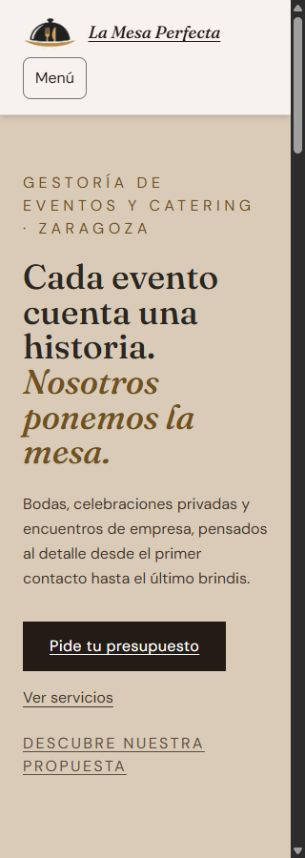
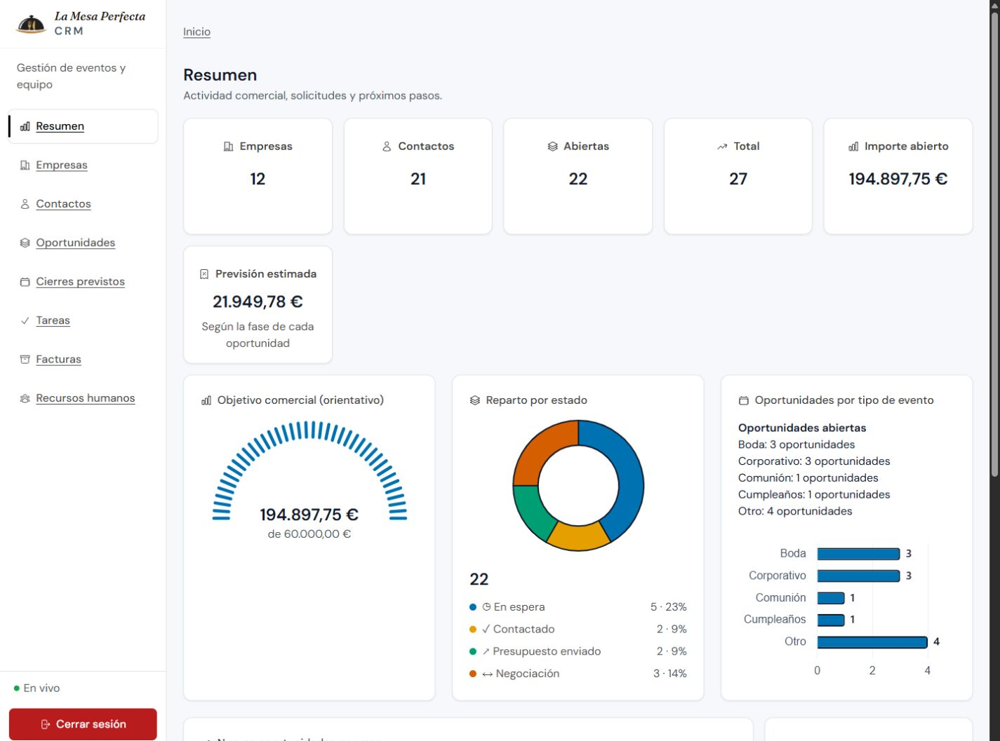

# Aplicación de Pautas_WCAG · 26/10/2026

Fuente: ZIP del usuario, conservado sin modificar en `Pautas_WCAG/`. Se han leído
el temario completo de 53 diapositivas, el anexo y el checklist de implementación.
El ZIP no incluye el PDF original: sus ilustraciones no se pueden auditar a partir
de la transcripción. Se conservan las pautas anteriores y la identidad de La Mesa
Perfecta. Las referencias ausentes de la guía ERP siguen sin estar disponibles.

## Barreras corregidas y alcance

| Página/componente | Criterio WCAG relacionado | Gravedad | Cambio previsto | Prueba | Estado |
| --- | --- | --- | --- | --- | --- |
| Portada/Hero | 1.4.3, 1.4.10, 2.2.2 | Alta | Texto visible en HTML inicial; foto debajo del texto en móvil; cabecera con fondo sólido | Navegador 320 px, captura y contraste | Corregido |
| Gráficos de resumen | 1.1.1, 1.4.1, 1.4.11 | Alta | Okabe–Ito, contornos oscuros, cantidades sobre barras, datos textuales siempre visibles y leyenda que se reorganiza | axe, captura, medidas y código | Corregido; falta prueba real de colores forzados |
| Formularios compartidos | 3.3.1, 3.3.2, 3.3.3 | Alta | Error que nombra el campo, resumen en orden del formulario, asociaciones aria-describedby y menos anuncios duplicados | Alta incompleta, candidatura incompleta y revisión pública sin enviar | Corregido; lectura con NVDA pendiente |
| Campos condicionales | 1.3.1, 4.1.2 | Alta | Regla hidden prioritaria frente a clases de presentación | Pasos ocultos: ninguno expuesto visualmente; respuestas conservadas | Corregido |
| Menús y diálogos | 2.1.1, 2.4.3, 4.1.2 | Alta | Mayús+Tab desde el diálogo va al último control; Tab vuelve al primero; Escape restaura foco; contenedor div con role=dialog | Prueba de teclado y axe | Corregido |
| Tablas, fichas y RRHH | 1.3.1, 1.4.10, 1.4.12 | Alta | Regiones desplazables existentes preservadas; fichas con estados que saltan de línea; errores/carga con h1 y anuncio | axe, 320 px, espaciado y texto 200 % | Corregido en muestra |
| Avatares y estados | 1.4.3 | Alta | Cian, azul, verde azulado y violeta más oscuros | axe y cálculo con fondos mezclados | Corregido |
| Tarjetas de oportunidad | 2.5.3 | Alta | Nombre accesible incluye todo el texto visible; prefijo oculto contenido dentro de la tarjeta | axe y ancho con texto 200 % | Corregido |
| Cabecera y menú CRM | 1.3.1, 1.4.10 | Media | Cabecera móvil semántica; alturas flexibles; menú de escritorio desplazable | axe y 320 px | Corregido |
| Navegación y fichas inexistentes | 2.4.2, 4.1.3 | Media | Conservada actualización de título; fichas de empresa/contacto/empleado con carga, error concreto y reintento | Tres UUID inexistentes, sin carga perpetua | Corregido |
| Multimedia y movimiento | 1.2.x, 2.2.2, 2.3.1 | Media | Sin audio ni vídeo; carrusel manual por defecto y movimiento reducido existente; sin pulso continuo del estado de conexión | Inventario de código | Sin multimedia que subtitular; prueba real de preferencia pendiente |

## Evidencias y resultados

Fecha: 26/10/2026. Navegador: Chromium integrado de Codex, en localhost. Axe-core
4.14.0, ejecutado por el proxy de pruebas `scripts/a11y-preview.cjs`. El proxy
inyecta la herramienta únicamente en la vista de pruebas; la aplicación publicada
no incluye axe ni el botón de auditoría. No se han enviado datos a un servicio de
auditoría externo. Los cambios anteriores del repositorio se han conservado.

- [Fuente verificada](fuente-verificada-2026-10-26.json): los seis archivos son
  idénticos, byte a byte, a sus entradas del ZIP.
- [Línea base](axe-baseline-2026-10-26.json): 37 elementos afectados en cuatro
  rutas por contraste o diferencia entre texto visible y nombre accesible.
- [Hallazgos adicionales](axe-hallazgos-adicionales-2026-10-26.json): contraste
  de fichas y semántica detectados durante las siguientes comprobaciones. Este
  archivo conserva los fallos anteriores a sus correcciones.
- [Resultado final axe](axe-final-2026-10-26.json): **0 infracciones detectadas
  en 17 URL y 25 combinaciones de página/estado**. No equivale a conformidad WCAG.
- [Reflujo y ampliación](reflujo-2026-10-26.json): documento de 305 px útiles en
  viewport de 320 px, sin desplazamiento horizontal de página en las rutas
  medidas. Las tablas de RRHH y el kanban conservan desplazamiento local, con
  región enfocable y nombre; no se ha confundido esto con desbordamiento de página.
- Texto al 200 % mediante raíz de 32 px en viewport 1280×900: documento de
  1265 px útiles y sin desbordamiento de página en los once destinos principales
  tras corregir Contactos y Oportunidades. **No es una prueba de zoom real del
  navegador**; esta continúa pendiente.
- Espaciado en 320 px: interlineado 1,5, párrafos 2 em, letras 0,12 em y palabras
  0,16 em. La cabecera pública mide 121 px y el primer texto empieza en 144 px;
  no lo cubre. La ficha de contacto dejó de desbordar tras permitir el salto de línea.
- [Contrastes calculados](contrastes-2026-10-26.json): avatar blanco/cian 5,36:1;
  estados en fondos claros mezclados entre 4,75:1 y 6,17:1; borde de campos sobre
  blanco 4,54:1; barras azules 5,19:1; texto secundario sobre blanco 7,59:1.
- [Regresión](regresion-2026-10-26.txt): compilación de producción correcta,
  acceso y doce rutas CRM con HTTP 200, **27 pruebas correctas, 0 fallos**. Incluye
  operaciones de RRHH, persistencia, formularios y API de facturas, con datos
  locales aislados. No se han guardado oportunidades, clientes ni empresas reales
  desde el navegador para probar accesibilidad.

### Rutas y estados revisados

| Grupo | URL o estado | Resultado axe final |
| --- | --- | --- |
| Web y acceso | `/`, `/crm/login` | 0 detectadas |
| Comercial | `/crm`, `/crm/empresas`, `/crm/contactos`, `/crm/oportunidades`, `/crm/cierres`, `/crm/tareas` | 0 detectadas |
| Otros módulos | `/crm/rrhh`, `/crm/facturas`, `/crm/empleados` | 0 detectadas |
| Fichas | Una ficha existente de empresas, contactos y empleados | 0 detectadas |
| Error | Las tres fichas con UUID inexistente | 0 detectadas |
| Diálogos | Alta con campo obligatorio vacío; ficha de oportunidad móvil; menú móvil; candidatura con errores | 0 detectadas |
| RRHH | Horarios, Selección y Evaluaciones | 0 detectadas |
| Formulario público | Todos los pasos hasta revisión; sin pulsar Enviar solicitud | 0 detectadas |

Los UUID, viewport y fechas exactos están en el JSON. Facturas muestra el error
real de configuración del entorno: no se ha inventado una tabla con datos ni
afirmado que esté probada contra una instalación configurada.

### Comprobaciones manuales realizadas

Diálogo de alta: error obligatorio visible junto al campo, aria-invalid y
aria-describedby correctos y foco en ese campo. El fondo queda inert. Desde el
contenedor inicial, Mayús+Tab enfoca Cancelar; Tab desde Cancelar enfoca Cerrar.
Escape cierra y devuelve el foco al botón Nueva oportunidad. La ficha de
oportunidad conserva el select nativo de estado como alternativa a arrastrar.
No se modificó su valor durante la prueba.

RRHH: flecha derecha desde Empleados cambia a Horarios y sincroniza selección y
panel. Candidatura incompleta conserva los campos, ofrece resumen enlazado y
errores asociados. Evaluaciones conserva radios nativos y descripción textual.
No se firmaron documentos ni se registraron evaluaciones durante las pruebas UI.

Formulario público: recorrido hasta revisión con datos ficticios, comprobación
de respuestas conservadas y fieldsets ocultos; no se envió la solicitud. En la
portada con espaciado aumentado no hay botones visibles menores de 44×44 px.
Esto es una muestra medida, no un certificado de todos los estados interactivos.

### Casos que axe deja para revisión humana

El resultado contiene `incomplete`: contraste sobre fotografías/canvas,
símbolos de flecha y estado, algunos solapamientos o recortes de zonas
desplazables. Se conserva cada caso en el JSON cuando la herramienta proporciona
el detalle. No se han eliminado resultados para presentar un cero.

La capa negra del 65 % en las fotos de Servicios deja, incluso sobre una foto
blanca, un fondo máximo aproximado #595959: texto #F7F2ED 6,30:1; numeración
grande #C9A876 3,12:1. La cabecera sólida tiene 5,58:1. Las flechas son símbolos
con nombre Servicio anterior/siguiente; el control de tarea muestra un símbolo y
su estado tiene texto en la misma fila. El indicador comercial incluye el importe
fuera del SVG; 17,74:1 sobre blanco. Estas comprobaciones explican casos concretos,
pero quedan pendientes revisión asistida y estados hover/activo exhaustivos.

## Checklist de la skill

«Pasa» se refiere a la muestra y evidencia indicada, no a una certificación global.

| Punto del checklist | Estado | Evidencia o límite |
| --- | --- | --- |
| Estructura, título, regiones y salto | Pasa en muestra | Axe, header móvil y h1 de carga/error |
| Alternativas de imágenes | Pasa en muestra | Portada informativa con alt; imágenes decorativas del carrusel con alt vacío |
| Botones, enlaces e iconos | Pasa en muestra | Tarjetas con nombre que incluye texto visible; select nativo para fases |
| Teclado, foco y Escape | Pasa en recorridos probados | Ciclo de foco corregido y retorno; falta recorrido exhaustivo de toda operación |
| Formularios y avisos | Pasa en muestra | Alta, candidatura y formulario público; lector de pantalla pendiente |
| Contraste texto/interfaz | Pasa en pares medidos | JSON de contraste y axe; revisión exhaustiva de todos los estados pendiente |
| Estados y gráficos | Pasa | Símbolo y texto; Okabe–Ito con contornos, cantidades y alternativa textual visible |
| Zoom, reflujo y espaciado | No probado completo | Reflujo, espaciado y texto 200 % probados; zoom real pendiente |
| Objetivos táctiles | Pasa en muestra | CSS común 44–48 px; muestra DOM pública con espaciado sin botones menores de 44 |
| Alternativa a arrastre/gestos | Pasa en muestra | Abrir tarjeta y cambiar select; carrusel con botones |
| Subtítulos y transcripciones | No aplica al contenido actual | No hay audio ni vídeo en las interfaces inspeccionadas |
| Movimiento y destellos | Pasa en código | CSS reduce, carrusel manual por defecto, gráficos sin animación; preferencia real pendiente |
| Alto contraste y enlaces | No probado completo | Enlaces subrayados y forced-colors implementado; canvas sustituido por datos textuales; falta prueba real |
| Lenguaje, coherencia y confirmaciones | Pasa en muestra | Datos de negocio conservados; revisión antes del envío y confirmaciones existentes |
| Herramientas y lector | No probado completo | Axe ejecutado; WAVE, Lighthouse y NVDA/VoiceOver/TalkBack no ejecutados |
| Evidencias por ruta y viewport | Pasa | JSON, capturas, línea base y registro de regresión |

## Pendientes y reproducción

Faltan pruebas reales con NVDA o Narrador, colores forzados/alto contraste del
sistema, daltonismo y visión borrosa, movimiento reducido activado en el sistema,
zoom real 200/400 %, revisión de estados interactivos y pruebas de Facturas con
servicio configurado. El PDF visual original y las cuatro referencias de la guía
ERP siguen ausentes. No se afirma conformidad WCAG completa ni se ha dado por
superado el checklist ausente del profesor.

Para repetir la auditoría local:

```powershell
npm install --prefix tmp/wcag-tools --no-audit --no-fund axe-core@4.14.0
$env:NEXT_DIST_DIR='.next-wcag53-dev'
$env:HR_STORAGE='local'
$env:HR_DATA_DIR="$PWD/tmp/wcag53-ui/rrhh-api-test"
npm run dev -- --port 3130
# En otra terminal:
node scripts/a11y-preview.cjs
```

Abrir http://127.0.0.1:3131. Usar el botón «Ejecutar auditoría local» o
Ctrl+Mayús+A con un diálogo abierto. El JSON queda en `script#a11y-audit`.
Los parámetros `?a11y=text-spacing` y `?a11y=text-200` pertenecen exclusivamente
al proxy de pruebas. Para regresión, compilar con NEXT_DIST_DIR=.next-wcag53-check
y ejecutar `node scripts/wcag-regression.cjs`; utiliza RRHH aislado en `tmp/`.

Referencias normativas consultadas: [WCAG 2.2](https://www.w3.org/TR/WCAG22/),
[contraste no textual](https://www.w3.org/WAI/WCAG22/Understanding/non-text-contrast.html)
y [espaciado](https://www.w3.org/WAI/WCAG22/Understanding/text-spacing.html).
16 px y 44–48 px son preferencias de comodidad de la guía; no se han presentado
como los umbrales normativos exactos de todos los criterios AA.




